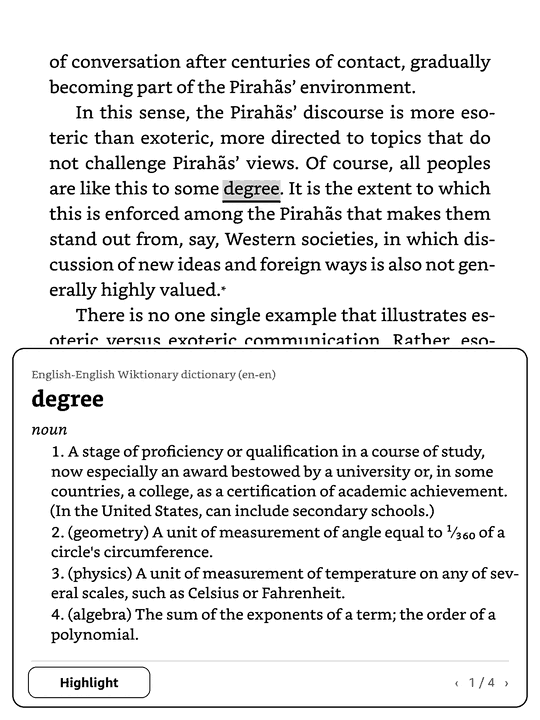
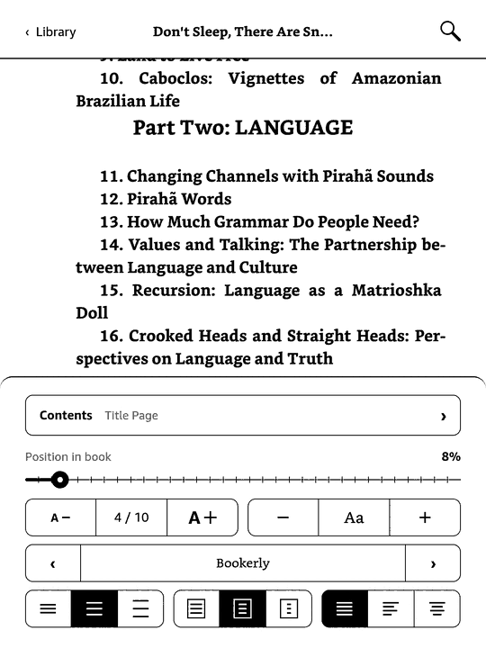
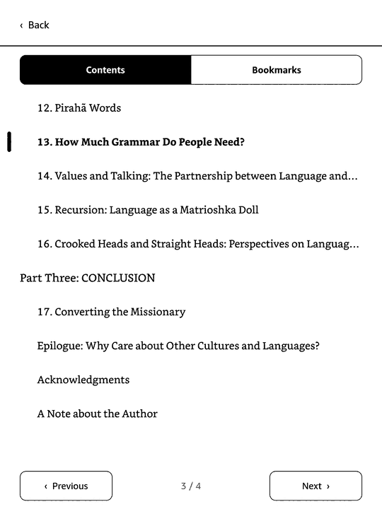
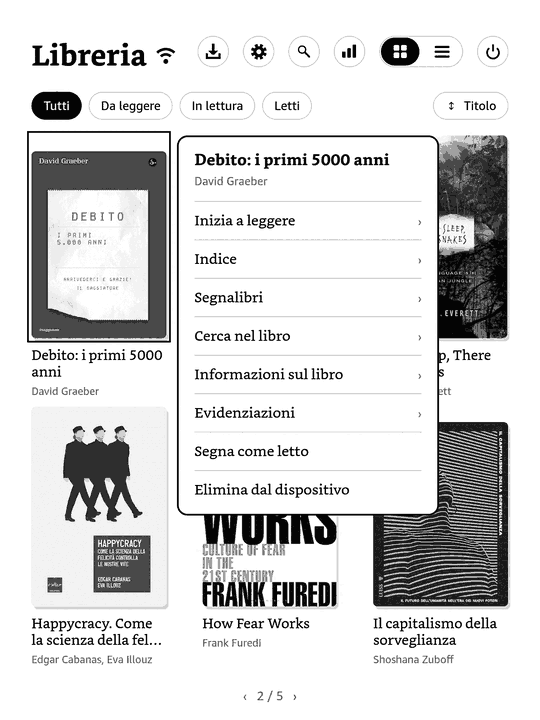
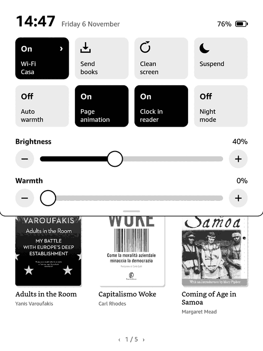
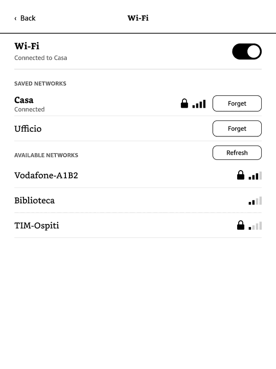
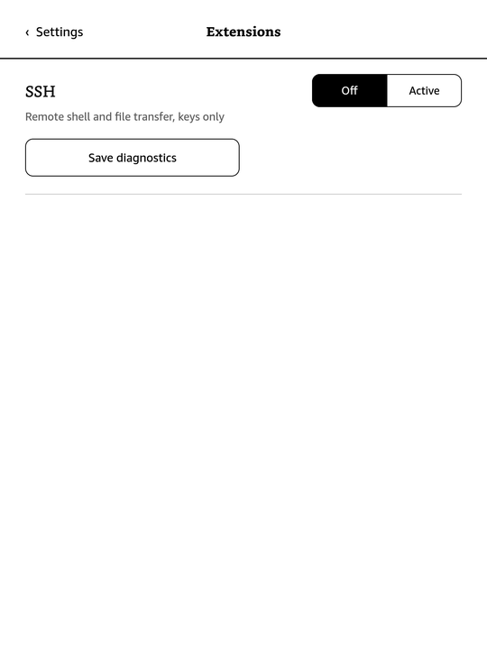
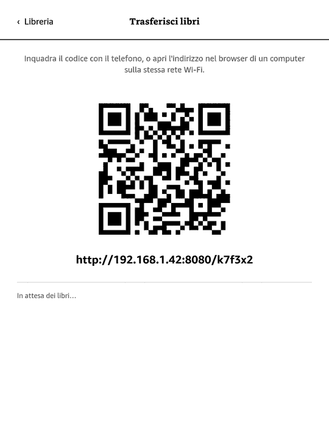

<div align="center">

# Zarathustra

### *Also sprach der Leser.*

**The Über-Reader for e-ink. Man is something that shall be overcome, and so is the stock Kindle UI.**

  

</div>

---

## Prologue

When Zarathustra was thirty years old, he left his home and went into the mountains, and there he read. For ten years he did not tire of it. But one morning he rose with the dawn, stepped before his Kindle, and spoke to it thus:

> *"You great device! What would your screen be, had you not the one who reads upon it? You have carried the same tired menus for years: the carousel of recommendations, the store that pokes its head into every page, the font menu designed by a committee of last men. I am weary of it, as a bee that has gathered too much honey. I must go down."*

So he went down, and wrote Zarathustra in Rust.

Zarathustra runs on a jailbroken Kindle Paperwhite 5, in place of the Amazon interface. One static binary is the whole interface. It has no store, no account, no cloud and no recommendations: you, your books, and a screen that does what you ask.

## Behold, I teach you the Über-Reader

The old readers are *décadents*. They justify text the way the herd walks, word by word, never looking at the paragraph. They hyphenate timidly or not at all. They reflow your page the moment you breathe on a setting. They serve a storefront and call it a home screen.

Zarathustra was built against all of that.

### An interface for free spirits

The decadent readers were designed by herd and for the herd: grey toolbars stacked like tax forms, menus three levels deep, settings that hide behind settings, a home screen that is a shop window with your books somewhere behind the glass. They are *infrolliti*, old men's interfaces, softened by years of committee meetings until nothing in them has an edge.

Zarathustra's interface was drawn for the eye and the thumb:

- **One gesture, one place.** Swipe down for light, warmth, Wi-Fi, night mode and suspend. Hold a cover for everything about that book. Tap the page for typography. Nothing is more than one step away.
- **Drawn for e-ink, not ported to it.** Each element is placed for a 300 dpi greyscale panel: crisp rules, generous margins, and icons drawn pixel by pixel instead of borrowed from a phone. Only the area that changed is refreshed, with the fastest waveform that still looks clean.
- **Your books first.** The home opens on the book you are reading and a line you underlined, then your library. There are no ads, no "recommended for you", no store.
- **A keyboard that keeps up.** Only the key you press and the field you type into are redrawn. Hold a letter for its accents. Tap shift for one capital, twice to lock it.
- **Bilingual.** English and Italian, switched in settings.

### Typography beyond good and evil

- **Knuth–Plass line breaking**: the whole paragraph is weighed before a single line is set, the way TeX does it. No rivers, no gaping justified lines.
- **Real hyphenation and margin protrusion**: punctuation hangs into the margin so the edge of the text looks straight to the eye, not just to the ruler.
- **Widows and orphans** are not left behind. The pagination looks ahead.
- **Weight you can choose.** How bold should the type be? Four steps, set live, and the page does not reflow.
- **The page stays visible while you set it.** The typography sheet is compact: size, weight, font, spacing, margins, alignment, each a tap away, with the result right above it.

<div align="center">
 
</div>

### What does not kill your reading makes it stronger

- **Tap a word** to get its dictionary entry in a card over the page (Wiktionary, StarDict).
- **Footnotes open where you are.** No jump to the end of the book and no hunt for the way back.
- **Highlights that follow your finger.** Hold a word and drag: the selection follows smoothly, takes the closing punctuation with it, and turns the page when you hold at its edge, so a passage can run across pages. Drop-shaped handles adjust either end.
- **Highlights and bookmarks** are kept in a SQLite store and gathered in a notebook per book. Jump to one and a pill takes you back to where you were.
- **Reading figures that tell the truth.** Time is counted per page the way KOReader does it: a page flicked past adds nothing, a page left open counts at most two minutes, and the clock stops while a menu is open or the Kindle sleeps.
- **Search** within a book or across the whole library.
- **The first page of your library quotes you back to yourself**: a highlight from the book you are reading, or your reading figures if you prefer them.

### The eternal return of your library

<div align="center">
  
</div>

- **Hold a book** and a menu opens beside its cover: open it, see its contents, bookmarks, highlights and details, search inside it, mark it read or unread, or delete it.
- **Swipe down from the top** for the quick panel: brightness, warmth (it can follow the clock), Wi-Fi, sending books, a clean refresh, suspend, page-turn animation, the clock while reading, and night mode.
- **Night mode** turns the page white on black. Covers and pictures keep their own tones.
- The library notices new books by itself, and you go back to it from a book in an instant.

### Extensions: become what you are

<div align="center">

</div>

A plugin is a folder: a `plugin.toml` and executables in any language. Drop it into `zarathustra/plugins/` and it shows up in **Settings → Extensions**, with its service switch, its settings and its actions as buttons.

- **Actions run in the background.** Tap one ("send my highlights", "sync with the server") and keep reading. While it runs you can stop it; an optional `timeout_seconds` stops it for you.
- **Failures are never hidden.** A failed run shows its error on the screen. Tap it for everything the action printed, its exit code and how long it took, without a computer.
- **Actions where you need them.** An action declared with `shown_in = ["book"]` appears in the book menu and receives that book.
- **In your language.** Plugins translate their strings with standard [Fluent](https://projectfluent.org) files (`locales/it.ftl`, `locales/en.ftl`).
- **SSH ships as the first plugin**: Dropbear and OpenSSH's `sftp-server`, built from source, public keys only, off until you switch it on.

The plugin format is described in `docs/superpowers/specs/2026-11-08-plugins-design.md` and `docs/superpowers/specs/2026-11-09-extensions-stats-design.md`.

### Send your books across the abyss

<div align="center">

</div>

Scan the code with your phone, or open the address in any browser on the same network. Choose your books and they fly into `library/`. No cable, no email-to-device, no account.

### Formats

EPUB · KEPUB · AZW3 · MOBI · PDF · TXT

## Thus spoke the engine

Zarathustra is written in Rust, with C only where C is clearly best (SQLite, MuPDF).

```
crates/zarathustra-device   the Kindle (MTK e-ink, touch, light, power, Wi-Fi), an emulator
crates/zarathustra-engine   fonts, DOM, CSS, layout, pagination, EPUB / MOBI / AZW3 / PDF / TXT
crates/zarathustra-store    SQLite: annotations, reading days, positions, preferences
crates/zarathustra          the shell: home, reader, panels, keyboard, plugins
dist/plugins/ssh            the SSH plugin
```

It cross-compiles to one static `armv7-unknown-linux-musleabihf` binary. A KUAL extension stops the Amazon framework while Zarathustra runs and brings it back when you leave. Drawing happens in RAM and only the refreshed rectangle is copied to the (uncached) framebuffer, so the library opens in about a tenth of a second and a selection follows the finger at a few milliseconds a frame.

## Become who you are: install it

You need a **jailbroken Kindle** with KUAL. It has been built for the Paperwhite 5 and the code is written to be portable. The first install goes over USB; after that, switch on the SSH extension, copy your public key into `zarathustra/plugins/ssh/authorized_keys`, and install over the network.

```sh
# the cross toolchain: arm-linux-musleabihf-cross-bin (AUR) for the C dependencies
scripts/build-ssh.sh                 # build the SSH plugin's Dropbear and sftp-server (pinned, verified)
make install-usb                     # onto a Kindle mounted over USB (KINDLE=/path to override)
make install-ssh                     # build, then install the app and the dictionaries over SSH
make update                          # the app only; the running Zarathustra restarts into it in seconds
make run-ssh BIN=zarathustra-probe   # install, run a binary on the device, show its log
```

Over SSH the Kindle is found on the network by itself (`KINDLE_HOST=1.2.3.4` to give its address). A new build copied over USB is picked up when the cable comes out.

Put your books in `/mnt/us/library` (by cable, or with the transfer screen), then start Zarathustra from KUAL.

On a desktop, without a Kindle:

```sh
cargo run --release -p zarathustra --bin zarathustra -- book.epub --pgm out/   # render every screen as images
cargo run -p zarathustra --features emulator --bin zarathustra-probe          # the emulator
```

## The last man asks: *"What is a page? What is a font? What is night?"*, and blinks.

The Übermensch reads.

---

<div align="center">

*"One must still have chaos in oneself to be able to give birth to a dancing star."*
<br>Zarathustra has the chaos in its issue tracker. The dancing star is on your screen.

**GPL-3.0-or-later** · not affiliated with Amazon · no book was harmed

</div>
